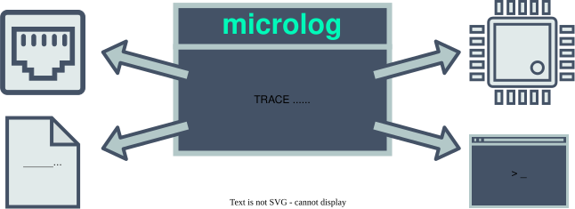
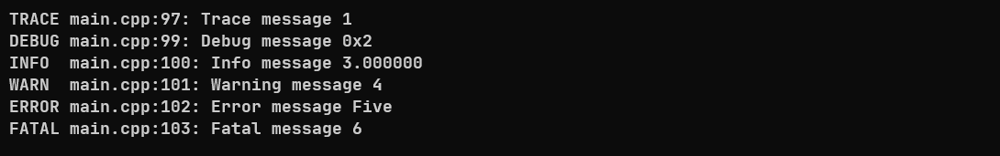
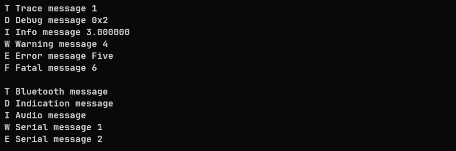
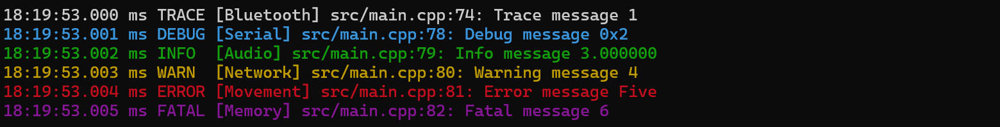

# microlog - Extensible and configurable logging library for embedded and desktop applications

[](https://opensource.org/licenses/MIT) [](https://github.com/an-dr/microlog/tags) [](https://github.com/an-dr/microlog/actions/workflows/workflow-tests.yml)

## Why microlog

microlog is a C/C++ logging library that started as a fork of [rxi/log.c](https://github.com/rxi/log.c). It works out of the box with two source files, and lets you strip every feature you do not use at compile time, so the same library fits a small microcontroller and a desktop application.



In the default configuration it looks like this:

|                                                            |
| ------------------------------------------------------------------------------------------------------ |
| Picture 1 - default configuration: no time, long default levels, source location, no topics, no colors |

...but it can be very minimalistic:

|                      |
| ---------------------------------------------------------------- |
| Picture 2 - short levels, no colors, no time, no source location |

... or feature-rich:

|                                                      |
| ------------------------------------------------------------------------------------------------ |
| Picture 3 - time, custom prefix for MsgID, custom syslog levels, topics, source location, colors |

## Table of Contents

- [Why microlog](#why-microlog)
- [Installation](#installation)
- [Quickstart](#quickstart)
- [Features](#features)
- [Configuration](#configuration)
- [Documentation](#documentation)
- [Development](#development)
- [Comparison with log.c](#comparison-with-logc)
- [Contributing](#contributing)
- [License](#license)
- [Status](#status)

## Installation

**Option 1 - Sources**:

- Download a Source Package from [Releases](https://github.com/an-dr/microlog/releases)
- Add sources to your system manually

**Option 2 - CMake Package (recommended CMake > 3.15.0)**:

- Download a CMake Package from [Releases](https://github.com/an-dr/microlog/releases)
- Specify the install location:
  - Specify package storage `cmake -B./build -DCMAKE_PREFIX_PATH="~/MyCmakePackages"` or
  - Set `microlog_DIR` variable with path to the package `microlog_DIR=~/microlog-1.2.3-cmake`
- Use in your project:

```cmake
find_package(microlog 1.2.3 REQUIRED)

add_executable(example_package example.cpp)
target_link_libraries(example_package PRIVATE microlog::microlog)

target_compile_definitions(microlog PRIVATE ULOG_BUILD_COLOR=1) # configuration

# Or use a user-defined configuration header `ulog_config.h`:
# target_compile_definitions(microlog PRIVATE ULOG_BUILD_CONFIG_HEADER_ENABLED=1)
# target_include_directories(microlog PRIVATE path/to/directory/containing/ulog_config.h)
```

**Option 3 - Meson Package**:

- Download a Meson Package from [Releases](https://github.com/an-dr/microlog/releases)
- Copy the content to `MyMesonProject/subprojects`
- Add to your dependencies:

```meson
add_global_arguments('-DULOG_BUILD_COLOR=1', language: ['cpp', 'c']) # configuration

# Or use a user-defined configuration header `ulog_config.h`:
# add_global_arguments('-DULOG_BUILD_CONFIG_HEADER_ENABLED=1', language: ['cpp', 'c'])
# And add include directory where ulog_config.h is located:
# add_global_arguments('-Ipath/to/directory/containing/ulog_config.h', language: ['cpp', 'c'])

exe = executable(
    meson.project_name(),
    src,
    include_directories: include,
    dependencies: dependency('microlog'),
)
```

**Option 4 - Meson Wrap File**:

- Download the wrap file from [Releases](https://github.com/an-dr/microlog/releases)
- Place `microlog.wrap` in your `MyMesonProject/subprojects/` directory
- Add to your dependencies as in Option 3

**Option 5 - CPM:**

- Download [CPM](https://github.com/cpm-cmake/CPM.cmake)
- Add microlog to your project's CMake file, replacing `X.Y.Z` with a release version:

```cmake
include(cpm/CPM.cmake)
CPMAddPackage("gh:an-dr/microlog@X.Y.Z")

target_link_libraries(${PROJECT_NAME} PUBLIC microlog::microlog)
target_compile_definitions(microlog PRIVATE ULOG_BUILD_COLOR=1) # configuration

# Or use a user-defined configuration header `ulog_config.h`:
# target_compile_definitions(microlog PRIVATE ULOG_BUILD_CONFIG_HEADER_ENABLED=1)
# target_include_directories(microlog PRIVATE path/to/directory/containing/ulog_config.h)
```

## Quickstart

```cpp
#include "ulog.h"

int main() {
    ulog_info("Hello, World");
    return 0;
}
```

Output:

```log
INFO  src/main.cpp:4: Hello, World
```

More features in action: [`example/main.cpp`](example/main.cpp).

## Features

- **Easy to use** - simple API, works out of the box
- **Advanced filtering** - log levels per **topic** or **output**
- **Thread-safety** - via external locking injection
- **Customization** - only the data you need
- **Extensible** - add your own features via the public API, or use the predefined [extensions](extensions/README.md)
- **Embedded-friendly** - static allocation, small size
- **Easy to install** - two files to copy-paste, plus packages for several build systems
- **For everyone** - C and C++ support, any compiler, any platform, commercial or open-source use

Core principles:

- No feature, no code for compilation
- Shallow learning curve, works out of the box
- No dependencies
- Extensions as recipes for your own features

## Configuration

Features are enabled and tuned at compile time with `ULOG_BUILD_*` definitions, passed as compiler flags or set in a user-defined `ulog_config.h`. Some of them can also be changed at run time when `ULOG_BUILD_DYNAMIC_CONFIG=1`. The full list of options and their defaults is in the [User Manual](doc/features.md).

## Documentation

- [User Manual](doc/features.md) - detailed information about the available features
- [Extensions](extensions/README.md) - optional add-ons that use only the public API: lock helpers for CMSIS, FreeRTOS, pthread, ThreadX and Windows, and a syslog level set
- [Design](doc/design.md), [code organization](doc/code.md) and [code style](doc/style.md) - for contributors
- [CHANGELOG.md](CHANGELOG.md) - release history

## Development

Run the unit tests (requires CMake and PowerShell; CI also installs lcov for coverage):

```bash
pwsh scripts/run_tests.ps1
```

See [CONTRIBUTING.md](CONTRIBUTING.md) for the rest of the build setup.

## Comparison with log.c

microlog started as a fork of [rxi/log.c](https://github.com/rxi/log.c) (~150 lines, 3.3k stars) but evolved into a fundamentally different architecture (~2,600 lines) optimized for embedded systems and advanced filtering. Thanks to compile-time feature stripping, unused features are excluded from the build—so a minimal microlog configuration can match log.c’s footprint in both size and performance.

### Core Differences

**rxi/log.c**: Minimalist and ready to use. Fixed footprint, 6 levels, simple callbacks.

**microlog**: Compile-time feature selection. Configurable footprint, 8 renameable levels, multi-dimensional filtering.

| Feature                   | log.c                                      | microlog                                                                       |
| ------------------------- | ------------------------------------------ | ------------------------------------------------------------------------------ |
| **Philosophy**            | Simple-to-use,  Minimalist for average use | Simple-to-use, extensible and configurable for diverse needs                   |
| **Configuration**         | Color, verbosity                           | ✅ Compile-time feature selection + optional runtime                            |
| **Runtime Configuration** | Only verbosity                             | ✅ Verbosity, color, time, prefix, source location, topics (Disablable feature) |
| **Zero-Overhead Disable** | Arguments still evaluated                  | ✅ True no-op with `ULOG_BUILD_DISABLED`                                        |
| **Log Levels**            | 6 fixed                                    | 8, runtime renameable (e.g., syslog)                                           |
| **Filtering**             | Global + per-callback                      | Per-output + per-topic + global                                                |
| **Topics/Subsystems**     | Manual prefixes                            | ✅ Full support with filtering per topic and routing                            |
| **Output Routing**        | All outputs get all logs                   | ✅ Route topics to specific or all outputs                                      |
| **Memory**                | Static                                     | ✅ Static or dynamic (user choice)                                              |
| **Build Systems**         | Manual integration                         | ✅ CMake, Meson, CPM packages                                                   |
| **Platform Helpers**      | DIY                                        | ✅ CMSIS, FreeRTOS, ThreadX, pthread, Win32                                     |

TL;DR:

- **When to choose log.c**:
    - Small projects needing basic logging with minimal setup.
- **When to choose microlog**:
    - Same scenarios, as default setup is just as simple.
    - Plus: embedded systems, multi-subsystem applications, or projects requiring fine-grained control and advanced filtering.

### Key Capabilities Unique to microlog

**1. Multi-Dimensional Filtering** - Per-output AND per-topic levels:

```c
ulog_topic_add("Credentials", secure_file_only, ULOG_LEVEL_TRACE);
ulog_topic_add("Network", ULOG_OUTPUT_ALL, ULOG_LEVEL_DEBUG);
ulog_output_level_set(ULOG_OUTPUT_STDOUT, ULOG_LEVEL_ERROR); // Console: errors only
```

**2. True Zero-Overhead Disable** - Arguments not evaluated:

```c
ulog_info("Result: %d", expensive()); // With ULOG_BUILD_DISABLED=1 → ((void)0)
```

**3. Custom Log Levels** - Redefine all 8 at runtime:

```c
ulog_level_descriptor syslog = {ULOG_LEVEL_7,
    {"DEBUG", "INFO", "NOTICE", "WARN", "ERR", "CRIT", "ALERT", "EMERG"}};
ulog_level_set_new_levels(&syslog);
```

**4. Fine-Grained Code Control** - build flags to strip features, see the [User Manual](doc/features.md):

```c
-DULOG_BUILD_SOURCE_LOCATION=0  // Remove file:line
-DULOG_BUILD_TIME=0             // Remove timestamps
-DULOG_BUILD_COLOR=0            // Remove ANSI codes
```

## Contributing

Contributions are welcome! Please read [CONTRIBUTING.md](CONTRIBUTING.md) for details.

## License

This library is free software; you can redistribute it and/or modify it under the terms of the MIT license. See [LICENSE](LICENSE) for details.

Based on [rxi/log.c](https://github.com/rxi/log.c).

## Status

Actively maintained; the latest release is listed in [CHANGELOG.md](CHANGELOG.md).
